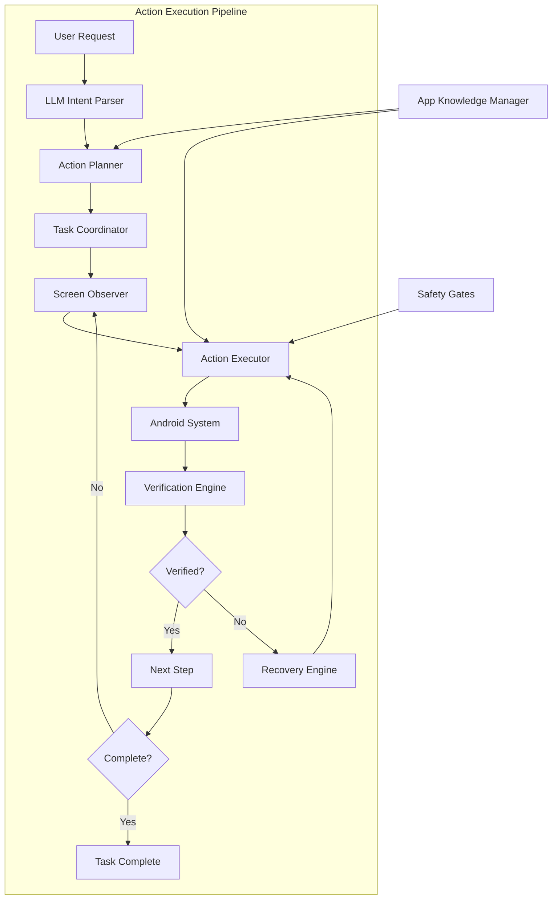

# ACTION_EXECUTION_SYSTEM.md
## Action Planning, Execution, Verification and Recovery

**Project:** MARK (formerly JARVIS) — Universal Android App Control System  
**Last Updated:** 2026-11-16

---

## 1. SYSTEM OVERVIEW

The Action Execution System is the core runtime that converts high-level user intents into concrete Android interactions. It operates as a **bounded multi-step task engine** with built-in verification and recovery.



### 1.1 Current MARK Implementation (Verified)

**LiveVoiceManager.kt** - Task State Machine:
```kotlin
private enum class TaskState {
    IDLE,
    OBSERVING,
    READY_TO_ACT,
    WAITING_FOR_CONFIRMATION,
    EXECUTING,
    VERIFYING,
    COMPLETED,
    FAILED,
    CANCELLED,
    ESCALATED
}
```

**Tool Flow:**
1. `start_task` → Initialize task state
2. `inspect_visible_screen` → Observe (sets state to OBSERVING/READY_TO_ACT)
3. `control_visible_screen` → Execute (sets state to EXECUTING → VERIFYING)
4. `complete_task` → Finalize (only from VERIFYING)
5. `cancel_task` → Abort at any point

**Safety Limits:**
- Max 24 steps per task (`MAX_TASK_STEPS = 24`)
- Confirmation required for sensitive actions
- Stale ref detection (snapshot versioning)
- Visual token expiry (15s, single-use)

---

## 2. ACTION PLANNER

### 2.1 Planning Input

```kotlin
data class PlanningContext(
    val userIntent: String,              // Original voice/text request
    val currentScreen: UnifiedScreen,    // Latest screen observation
    val targetApp: AppKnowledge,         // Loaded app knowledge
    val taskHistory: List<ExecutedStep>, // Steps taken so far
    val globalState: GlobalState,        // Device state, permissions, etc.
    val safetyConstraints: SafetyConstraints
)
```

### 2.2 Planning Algorithm

```kotlin
class ActionPlanner(
    private val appKnowledgeManager: AppKnowledgeManager,
    private val llmClient: LlmClient  // For complex reasoning
) {
    
    fun createPlan(context: PlanningContext): ActionPlan {
        // 1. Identify target app from intent
        val targetPackage = extractPackage(context.userIntent) 
            ?: context.currentScreen.packageName
            ?: throw PlanningException("Cannot determine target app")
        
        // 2. Load app knowledge
        val appKnowledge = appKnowledgeManager.getKnowledge(targetPackage)
            ?: return genericPlan(context)  // Fallback to generic
        
        // 3. Classify current screen
        val currentScreenType = classifyScreen(context.currentScreen)
        
        // 4. Find matching workflow
        val workflow = findWorkflow(appKnowledge, context.userIntent, currentScreenType)
        
        if (workflow != null) {
            return instantiateWorkflow(workflow, context)
        }
        
        // 5. No workflow found → LLM-based planning
        return llmPlan(context, appKnowledge)
    }
    
    private fun findWorkflow(
        knowledge: AppKnowledge, 
        intent: String, 
        screenType: ScreenClass
    ): Workflow? {
        // Match by intent keywords + current screen
        return knowledge.workflows.values.firstOrNull { workflow ->
            workflow.triggers.any { intent.contains(it, ignoreCase = true) } &&
            (workflow.startScreen == null || workflow.startScreen == screenType)
        }
    }
    
    private fun instantiateWorkflow(workflow: Workflow, context: PlanningContext): ActionPlan {
        val steps = workflow.steps.map { step ->
            ActionStep.fromTemplate(step, context.params, context.currentScreen)
        }
        return ActionPlan(
            steps = steps,
            requiresConfirmation = steps.any { it.requiresConfirmation },
            estimatedDuration = steps.sumOf { it.estimatedDuration }
        )
    }
}
```

### 2.3 Generic Planning (No Workflow)

When no predefined workflow exists, use LLM + heuristics:

```kotlin
private fun genericPlan(context: PlanningContext): ActionPlan {
    // Use LLM to reason about steps
    val prompt = """
        User wants: ${context.userIntent}
        Current screen: ${context.currentScreen.summary}
        Target app: ${context.targetApp.appName}
        Available actions: tap, type, scroll, swipe, back, home, long_press
        Known elements: ${context.currentScreen.actionableElements.map { it.summary }.joinToString(", ")}
        
        Plan the next 1-3 steps. Return JSON array of steps.
        Each step: {action, target, params, verification, requiresConfirmation}
    """.trimIndent()
    
    val llmResponse = llmClient.complete(prompt)
    return parseLlmPlan(llmResponse, context)
}
```

### 2.4 ActionStep Template Resolution

```kotlin
data class ActionStepTemplate(
    val action: String,                    // "tap", "type", "scroll", etc.
    val targetRole: String,                // "send_button", "message_input"
    val params: Map<String, String> = emptyMap(),
    val verification: VerificationTemplate,
    val requiresConfirmation: Boolean = false,
    val fallback: List<ActionStepTemplate> = emptyList()
)

fun ActionStep.fromTemplate(
    template: ActionStepTemplate,
    params: Map<String, String>,
    screen: UnifiedScreen
): ActionStep {
    // Resolve target element
    val targetRef = screen.findElementByRole(template.targetRole)
        ?: throw PlanningException("Target element not found: ${template.targetRole}")
    
    // Resolve parameters with substitution
    val resolvedParams = template.params.mapValues { (k, v) -> 
        v.replace("{{param}}", params["param"] ?: "") 
    }
    
    return when (template.action) {
        "tap" -> ActionStep.Tap(targetRef.ref, template.targetRole, template.verification.toStep())
        "type" -> ActionStep.Type(targetRef.ref, resolvedParams["text"]!!, template.verification.toStep())
        "scroll" -> ActionStep.Scroll(targetRef.ref, resolvedParams["direction"]!!, template.verification.toStep())
        // ... other actions
        else -> throw PlanningException("Unknown action: ${template.action}")
    }
}
```

---

## 3. TASK COORDINATOR

### 3.1 Task Lifecycle Management

```kotlin
class TaskCoordinator(
    private val planner: ActionPlanner,
    private val executor: ActionExecutor,
    private val verifier: VerificationEngine,
    private val recovery: RecoveryEngine,
    private val safetyGates: SafetyGates
) {
    
    private var currentTask: TaskSession? = null
    private val maxSteps = 24
    
    fun startTask(intent: String): TaskResult {
        currentTask = TaskSession(
            intent = intent,
            startTime = System.currentTimeMillis(),
            stepCount = 0
        )
        return TaskResult(status = "started", message = "Task initialized. Ready to observe.")
    }
    
    fun executeNextStep(screen: UnifiedScreen): TaskResult {
        val task = currentTask ?: return TaskResult.failed("No active task. Call start_task first.")
        
        if (task.stepCount >= maxSteps) {
            cancelTask()
            return TaskResult.failed("Max steps ($maxSteps) exceeded. Task cancelled.")
        }
        
        // Check if waiting for confirmation
        if (task.awaitingConfirmation) {
            return TaskResult.confirmationRequired("Waiting for user confirmation.")
        }
        
        // Plan next step
        val plan = planner.createPlan(PlanningContext(
            userIntent = task.intent,
            currentScreen = screen,
            targetApp = appKnowledgeManager.getKnowledge(screen.packageName)!!,
            taskHistory = task.executedSteps,
            globalState = getGlobalState(),
            safetyConstraints = safetyGates.getConstraints()
        ))
        
        if (plan.steps.isEmpty()) {
            return TaskResult.failed("No plan generated.")
        }
        
        // Execute first step
        val step = plan.steps.first()
        task.stepCount++
        task.currentStep = step
        
        // Check safety gates
        if (safetyGates.requiresConfirmation(step)) {
            task.awaitingConfirmation = true
            return TaskResult.confirmationRequired(
                "Confirmation required: ${safetyGates.getConfirmationPrompt(step)}"
            )
        }
        
        // Execute
        val result = executor.execute(step, screen)
        task.lastResult = result
        
        if (!result.success) {
            return handleFailure(task, step, result)
        }
        
        // Verify
        val verification = verifier.verify(step, result.newScreen!!)
        if (!verification.passed) {
            return handleVerificationFailure(task, step, verification)
        }
        
        // Step verified
        task.executedSteps.add(ExecutedStep(step, result, verification))
        task.awaitingConfirmation = false
        
        if (verification.taskComplete) {
            return completeTask(task)
        }
        
        return TaskResult.success("Step completed. Ready for next action.", task.stepCount)
    }
    
    fun confirmAndRetry(): TaskResult {
        val task = currentTask ?: return TaskResult.failed("No active task.")
        if (!task.awaitingConfirmation) {
            return TaskResult.failed("No confirmation pending.")
        }
        task.awaitingConfirmation = false
        // Re-execute current step with confirmed=true
        return executeConfirmedStep(task)
    }
    
    fun cancelTask(): TaskResult {
        currentTask = null
        return TaskResult.cancelled("Task cancelled.")
    }
    
    fun completeTask(task: TaskSession): TaskResult {
        currentTask = null
        return TaskResult.completed("Task completed successfully in ${task.stepCount} steps.")
    }
}
```

### 3.2 Task Session State

```kotlin
data class TaskSession(
    val intent: String,
    val startTime: Long,
    var stepCount: Int = 0,
    var currentStep: ActionStep? = null,
    var lastResult: ExecutionResult? = null,
    var awaitingConfirmation: Boolean = false,
    val executedSteps: MutableList<ExecutedStep> = mutableListOf()
)

data class ExecutedStep(
    val step: ActionStep,
    val result: ExecutionResult,
    val verification: VerificationResult
)

data class TaskResult(
    val status: String,  // success, failed, confirmation_required, cancelled, completed
    val message: String,
    val stepCount: Int = 0,
    val data: JSONObject? = null
) {
    companion object {
        fun success(msg: String, stepCount: Int = 0) = TaskResult("success", msg, stepCount)
        fun failed(msg: String) = TaskResult("failed", msg)
        fun confirmationRequired(msg: String) = TaskResult("confirmation_required", msg)
        fun cancelled(msg: String) = TaskResult("cancelled", msg)
        fun completed(msg: String) = TaskResult("completed", msg)
    }
}
```

---

## 4. ACTION EXECUTOR

### 4.1 Execution Interface

```kotlin
interface ActionExecutor {
    fun execute(step: ActionStep, screen: UnifiedScreen): ExecutionResult
}

class AccessibilityActionExecutor(
    private val accessibilityService: JarvisAccessibilityService
) : ActionExecutor {
    
    override fun execute(step: ActionStep, screen: UnifiedScreen): ExecutionResult {
        return when (step) {
            is ActionStep.Tap -> executeTap(step, screen)
            is ActionStep.Type -> executeType(step, screen)
            is ActionStep.Scroll -> executeScroll(step, screen)
            is ActionStep.Swipe -> executeSwipe(step, screen)
            is ActionStep.Drag -> executeDrag(step, screen)
            is ActionStep.LongPress -> executeLongPress(step, screen)
            is ActionStep.GlobalAction -> executeGlobalAction(step)
            is ActionStep.IntentAction -> executeIntent(step)
            is ActionStep.Wait -> executeWait(step)
            is ActionStep.VerifyScreen -> executeVerifyScreen(step, screen)
            else -> ExecutionResult.failed("Unknown action type: ${step.javaClass.simpleName}")
        }
    }
    
    private fun executeTap(step: ActionStep.Tap, screen: UnifiedScreen): ExecutionResult {
        // 1. Resolve ref to current node
        val node = screen.resolveRef(step.ref)
            ?: return ExecutionResult.failed("STALE_REF", "Ref not found in current screen")
        
        if (!node.isVisibleToUser) {
            return ExecutionResult.failed("NOT_VISIBLE", "Element no longer visible")
        }
        if (!node.isEnabled) {
            return ExecutionResult.failed("DISABLED", "Element is disabled")
        }
        
        // 2. Try accessibility click first
        val clickable = findClickableAncestor(node) ?: node
        var success = clickable.performAction(AccessibilityNodeInfo.ACTION_CLICK)
        
        // 3. Fallback: gesture to bounds center
        if (!success) {
            val bounds = Rect()
            clickable.getBoundsInScreen(bounds)
            success = dispatchTapGesture(bounds.centerX(), bounds.centerY())
        }
        
        return if (success) {
            ExecutionResult.success("Tapped ${step.target}")
        } else {
            ExecutionResult.failed("GESTURE_REJECTED", "Both click and gesture failed")
        }
    }
    
    private fun executeType(step: ActionStep.Type, screen: UnifiedScreen): ExecutionResult {
        val node = screen.resolveRef(step.ref)
            ?: return ExecutionResult.failed("STALE_REF", "Ref not found")
        
        val editable = findEditableDescendant(node) ?: node
        if (!editable.isEditable) {
            return ExecutionResult.failed("NOT_EDITABLE", "Element is not editable")
        }
        
        val arguments = Bundle().apply {
            putCharSequence(AccessibilityNodeInfo.ACTION_ARGUMENT_SET_TEXT_CHARSEQUENCE, step.text)
        }
        val success = editable.performAction(AccessibilityNodeInfo.ACTION_SET_TEXT, arguments)
        
        return if (success) {
            ExecutionResult.success("Typed into ${step.target}")
        } else {
            ExecutionResult.failed("TYPE_FAILED", "Could not set text")
        }
    }
    
    private fun executeScroll(step: ActionStep.Scroll, screen: UnifiedScreen): ExecutionResult {
        val node = screen.resolveRef(step.ref)
            ?: return ExecutionResult.failed("STALE_REF", "Ref not found")
        
        if (!node.isScrollable) {
            return ExecutionResult.failed("NOT_SCROLLABLE", "Element is not scrollable")
        }
        
        val action = when (step.direction) {
            "up", "backward" -> AccessibilityNodeInfo.ACTION_SCROLL_BACKWARD
            "down", "forward" -> AccessibilityNodeInfo.ACTION_SCROLL_FORWARD
            else -> return ExecutionResult.failed("INVALID_DIRECTION", "Use up/down")
        }
        
        val success = node.performAction(action)
        return if (success) {
            ExecutionResult.success("Scrolled ${step.direction}")
        } else {
            ExecutionResult.failed("SCROLL_FAILED", "Could not scroll")
        }
    }
    
    private fun executeSwipe(step: ActionStep.Swipe, screen: UnifiedScreen): ExecutionResult {
        val path = Path().apply {
            moveTo(step.from.x, step.from.y)
            lineTo(step.to.x, step.to.y)
        }
        val stroke = GestureDescription.StrokeDescription(path, 0, 300)
        val gesture = GestureDescription.Builder().addStroke(stroke).build()
        val accepted = accessibilityService.dispatchGesture(gesture, null, null)
        
        return if (accepted) ExecutionResult.success("Swiped") 
        else ExecutionResult.failed("GESTURE_REJECTED", "Swipe gesture rejected")
    }
    
    private fun executeDrag(step: ActionStep.Drag, screen: UnifiedScreen): ExecutionResult {
        val path = Path().apply {
            moveTo(step.from.x, step.from.y)
            // Add intermediate point for natural curve
            lineTo((step.from.x + step.to.x) / 2, (step.from.y + step.to.y) / 2)
            lineTo(step.to.x, step.to.y)
        }
        val duration = calculateDragDuration(step.from, step.to)
        val stroke = GestureDescription.StrokeDescription(path, 0, duration)
        val gesture = GestureDescription.Builder().addStroke(stroke).build()
        val accepted = accessibilityService.dispatchGesture(gesture, null, null)
        
        return if (accepted) ExecutionResult.success("Dragged")
        else ExecutionResult.failed("GESTURE_REJECTED", "Drag gesture rejected")
    }
    
    private fun executeLongPress(step: ActionStep.LongPress, screen: UnifiedScreen): ExecutionResult {
        val node = screen.resolveRef(step.ref)
            ?: return ExecutionResult.failed("STALE_REF", "Ref not found")
        
        val target = findLongClickableAncestor(node) ?: node
        val bounds = Rect()
        target.getBoundsInScreen(bounds)
        
        val path = Path().apply { moveTo(bounds.centerX().toFloat(), bounds.centerY().toFloat()) }
        val duration = ViewConfiguration.getLongPressTimeout().toLong()
        val stroke = GestureDescription.StrokeDescription(path, 0, duration)
        val gesture = GestureDescription.Builder().addStroke(stroke).build()
        val accepted = accessibilityService.dispatchGesture(gesture, null, null)
        
        return if (accepted) ExecutionResult.success("Long-pressed ${step.target}")
        else ExecutionResult.failed("GESTURE_REJECTED", "Long press rejected")
    }
    
    private fun executeGlobalAction(step: ActionStep.GlobalAction): ExecutionResult {
        val action = when (step.action) {
            ActionStep.GlobalActionType.BACK -> AccessibilityService.GLOBAL_ACTION_BACK
            ActionStep.GlobalActionType.HOME -> AccessibilityService.GLOBAL_ACTION_HOME
            ActionStep.GlobalActionType.RECENTS -> AccessibilityService.GLOBAL_ACTION_RECENTS
            ActionStep.GlobalActionType.NOTIFICATIONS -> AccessibilityService.GLOBAL_ACTION_NOTIFICATIONS
            ActionStep.GlobalActionType.QUICK_SETTINGS -> AccessibilityService.GLOBAL_ACTION_QUICK_SETTINGS
        }
        val success = accessibilityService.performGlobalAction(action)
        return if (success) ExecutionResult.success("Global action: ${step.action}")
        else ExecutionResult.failed("GLOBAL_ACTION_FAILED", "Action rejected")
    }
    
    private fun executeIntent(step: ActionStep.IntentAction): ExecutionResult {
        try {
            accessibilityService.context.startActivity(step.intent)
            ExecutionResult.success("Intent launched")
        } catch (e: Exception) {
            ExecutionResult.failed("INTENT_FAILED", e.message ?: "Unknown error")
        }
    }
    
    private fun executeWait(step: ActionStep.Wait): ExecutionResult {
        Thread.sleep(step.timeoutMs)
        ExecutionResult.success("Waited ${step.timeoutMs}ms")
    }
    
    private fun executeVerifyScreen(step: ActionStep.VerifyScreen, screen: UnifiedScreen): ExecutionResult {
        val missing = step.expectedElements.filterNot { name ->
            screen.elements.any { it.text.contains(name, ignoreCase = true) || it.description.contains(name, ignoreCase = true) }
        }
        if (missing.isEmpty()) {
            ExecutionResult.success("Screen verified")
        } else {
            ExecutionResult.failed("VERIFICATION_FAILED", "Missing expected elements: ${missing.joinToString(", ")}")
        }
    }
}
```

### 4.2 Execution Result

```kotlin
data class ExecutionResult(
    val success: Boolean,
    val message: String,
    val newScreenSnapshot: ScreenSnapshot? = null,
    val verified: Boolean = false,
    val retryable: Boolean = false,
    val errorType: ErrorType? = null
) {
    companion object {
        fun success(msg: String) = ExecutionResult(true, msg)
        fun failed(errorType: ErrorType, msg: String) = ExecutionResult(
            false, msg, errorType = errorType, retryable = errorType.isRetryable()
        )
    }
}

enum class ErrorType {
    STALE_REF,
    AMBIGUOUS_TARGET,
    DISABLED_TARGET,
    NOT_FOUND,
    NOT_VISIBLE,
    NOT_EDITABLE,
    NOT_SCROLLABLE,
    PERMISSION_DIALOG,
    LOADING_SCREEN,
    UNEXPECTED_SCREEN,
    GESTURE_REJECTED,
    TIMEOUT,
    SECURE_WINDOW,
    INTENT_FAILED,
    TYPE_FAILED,
    SCROLL_FAILED,
    VERIFICATION_FAILED,
    INVALID_DIRECTION,
    GLOBAL_ACTION_FAILED,
    UNKNOWN;
    
    fun isRetryable(): Boolean = this in setOf(
        TIMEOUT, GESTURE_REJECTED, LOADING_SCREEN, STALE_REF
    )
}
```

---

## 5. VERIFICATION ENGINE

### 5.1 Verification Strategies

```kotlin
interface VerificationEngine {
    fun verify(step: ActionStep, newScreen: UnifiedScreen): VerificationResult
}

class CompositeVerificationEngine(
    private val treeDiffVerifier: TreeDiffVerifier,
    val elementPresenceVerifier: ElementPresenceVerifier,
    val textContentVerifier: TextContentVerifier,
    val screenChangeVerifier: ScreenChangeVerifier,
    val globalStateVerifier: GlobalStateVerifier
) : VerificationEngine {
    
    override fun verify(step: ActionStep, newScreen: UnifiedScreen): VerificationResult {
        val verifiers = step.verification.verifiers
        val results = verifiers.map { verifier ->
            when (verifier.type) {
                VerificationType.TREE_DIFF -> treeDiffVerifier.verify(step, newScreen, verifier)
                VerificationType.ELEMENT_PRESENT -> elementPresenceVerifier.verify(step, newScreen, verifier)
                VerificationType.ELEMENT_GONE -> elementPresenceVerifier.verifyGone(step, newScreen, verifier)
                VerificationType.TEXT_CONTAINS -> textContentVerifier.verify(step, newScreen, verifier)
                VerificationType.SCREEN_CHANGE -> screenChangeVerifier.verify(step, newScreen, verifier)
                VerificationType.GLOBAL_STATE -> globalStateVerifier.verify(step, newScreen, verifier)
                VerificationType.CUSTOM -> customVerify(step, newScreen, verifier)
            }
        }
        
        val allPassed = results.all { it.passed }
        val taskComplete = results.any { it.taskComplete }
        
        return VerificationResult(
            passed = allPassed,
            results = results,
            taskComplete = taskComplete
        )
    }
}
```

### 5.2 Tree Diff Verifier

```kotlin
class TreeDiffVerifier : Verifier {
    override fun verify(step: ActionStep, newScreen: UnifiedScreen, config: VerificationConfig): VerificationResult {
        // Compare before/after accessibility trees
        // For now, simplified: check expected state changes
        
        return when (step) {
            is ActionStep.Tap -> verifyTap(step, newScreen)
            is ActionStep.Type -> verifyType(step, newScreen)
            is ActionStep.Scroll -> verifyScroll(step, newScreen)
            is ActionStep.LongPress -> verifyLongPress(step, newScreen)
            else -> VerificationResult.passed()
        }
    }
    
    private fun verifyTap(step: ActionStep.Tap, newScreen: UnifiedScreen): VerificationResult {
        // Tap verification depends on target type
        return when {
            // Navigation: package/activity changed
            step.target in setOf("navigation_item", "tab", "link") -> {
                val changed = newScreen.packageName != step.previousScreen?.packageName ||
                    newScreen.activityName != step.previousScreen?.activityName
                VerificationResult(passed = changed, taskComplete = changed)
            }
            // Toggle: checkbox/switch state changed
            step.target in setOf("checkbox", "switch", "toggle") -> {
                val element = newScreen.findElementByRef(step.ref)
                val changed = element?.states?.contains("checked") != step.previousScreen?.findElementByRef(step.ref)?.states?.contains("checked")
                VerificationResult(passed = changed)
            }
            // Dialog/menu opened
            step.target in setOf("menu_button", "overflow", "more_options") -> {
                val hasDialog = newScreen.elements.any { it.role in setOf("AlertDialog", "PopupMenu", "BottomSheetDialog") }
                VerificationResult(passed = hasDialog)
            }
            else -> VerificationResult.passed()  // Default: assume tap worked
        }
    }
    
    private fun verifyType(step: ActionStep.Type, newScreen: UnifiedScreen): VerificationResult {
        val element = newScreen.findElementByRef(step.ref)
        val hasText = element?.text?.contains(step.text, ignoreCase = true) == true
        VerificationResult(passed = hasText)
    }
    
    private fun verifyScroll(step: ActionStep.Scroll, newScreen: UnifiedScreen): VerificationResult {
        // Check if first/last visible item changed
        val element = newScreen.findElementByRef(step.ref)
        val contentChanged = element?.childrenRefs?.firstOrNull() != step.previousScreen?.findElementByRef(step.ref)?.childrenRefs?.firstOrNull()
        VerificationResult(passed = contentChanged)
    }
}
```

### 5.3 Element Presence Verifier

```kotlin
class ElementPresenceVerifier : Verifier {
    override fun verify(step: ActionStep, newScreen: UnifiedScreen, config: VerificationConfig): VerificationResult {
        val targetRole = config.params["targetRole"] ?: return VerificationResult.failed("No targetRole")
        val timeout = config.params["timeoutMs"]?.toLong() ?: 3000
        
        val found = waitForElement(newScreen, targetRole, timeout)
        VerificationResult(passed = found)
    }
    
    fun verifyGone(step: ActionStep, newScreen: UnifiedScreen, config: VerificationConfig): VerificationResult {
        val targetRole = config.params["targetRole"] ?: return VerificationResult.failed("No targetRole")
        val timeout = config.params["timeoutMs"]?.toLong() ?: 3000
        
        val gone = waitForElementGone(newScreen, targetRole, timeout)
        VerificationResult(passed = gone)
    }
    
    private fun waitForElement(screen: UnifiedScreen, role: String, timeoutMs: Long): Boolean {
        val startTime = System.currentTimeMillis()
        while (System.currentTimeMillis() - startTime < timeoutMs) {
            if (screen.elements.any { it.role == role }) return true
            Thread.sleep(200)
            // Re-inspect would happen in real implementation
        }
        return false
    }
}
```

### 5.4 Verification Result

```kotlin
data class VerificationResult(
    val passed: Boolean,
    val results: List<SingleVerificationResult> = emptyList(),
    val taskComplete: Boolean = false,
    val message: String = ""
) {
    companion object {
        fun passed() = VerificationResult(true)
        fun failed(msg: String) = VerificationResult(false, message = msg)
    }
}

data class SingleVerificationResult(
    val verifier: String,
    val passed: Boolean,
    val message: String = "",
    val taskComplete: Boolean = false
)
```

---

## 6. RECOVERY ENGINE

### 6.1 Failure Classification

```kotlin
class RecoveryEngine(
    private val screenObserver: ScreenObserver,
    private val planner: ActionPlanner,
    private val executor: ActionExecutor
) {
    
    fun recover(task: TaskSession, step: ActionStep, result: ExecutionResult): RecoveryAction {
        val errorType = result.errorType ?: ErrorType.UNKNOWN
        
        return when (errorType) {
            ErrorType.STALE_REF -> recoverStaleRef(task)
            ErrorType.AMBIGUOUS_TARGET -> recoverAmbiguousTarget(task, step)
            ErrorType.DISABLED_TARGET -> recoverDisabledTarget(task, step)
            ErrorType.NOT_FOUND -> recoverNotFound(task, step)
            ErrorType.NOT_VISIBLE -> recoverNotVisible(task, step)
            ErrorType.PERMISSION_DIALOG -> recoverPermissionDialog(task)
            ErrorType.LOADING_SCREEN -> recoverLoadingScreen(task)
            ErrorType.UNEXPECTED_SCREEN -> recoverUnexpectedScreen(task)
            ErrorType.GESTURE_REJECTED -> recoverGestureRejected(task, step)
            ErrorType.TIMEOUT -> recoverTimeout(task, step)
            ErrorType.SECURE_WINDOW -> recoverSecureWindow(task)
            else -> RecoveryAction.escalate("Unknown error: $errorType")
        }
    }
    
    private fun recoverStaleRef(task: TaskSession): RecoveryAction {
        // Re-inspect screen, re-plan
        return RecoveryAction.reinspectAndReplan("Screen changed, ref stale")
    }
    
    private fun recoverAmbiguousTarget(task: TaskSession, step: ActionStep): RecoveryAction {
        // Re-inspect, if still ambiguous ask user
        return RecoveryAction.reinspectAndReplan("Multiple matching elements")
    }
    
    private fun recoverDisabledTarget(task: TaskSession, step: ActionStep): RecoveryAction {
        // Wait and retry, or find alternative
        return RecoveryAction.waitAndRetry(2000, "Element disabled, waiting")
    }
    
    private fun recoverNotFound(task: TaskSession, step: ActionStep): RecoveryAction {
        // Try: scroll, navigate, search, explore
        return RecoveryAction.explore("Element not found, exploring")
    }
    
    private fun recoverPermissionDialog(task: TaskSession): RecoveryAction {
        // Notify user, wait for dismissal
        return RecoveryAction.userGuidance("Permission dialog shown. Please respond, then I'll continue.")
    }
    
    private fun recoverLoadingScreen(task: TaskSession): RecoveryAction {
        // Wait with timeout
        return RecoveryAction.waitAndRetry(10000, "Loading screen detected, waiting")
    }
    
    private fun recoverUnexpectedScreen(task: TaskSession): RecoveryAction {
        // Navigate back to known state
        return RecoveryAction.navigateBackToKnown("Unexpected screen, returning to known state")
    }
    
    private fun recoverGestureRejected(task: TaskSession, step: ActionStep): RecoveryAction {
        // Retry with adjusted coordinates or different method
        return RecoveryAction.retryWithAdjustment("Gesture rejected, adjusting")
    }
}
```

### 6.2 Recovery Actions

```kotlin
sealed class RecoveryAction {
    data class ReinspectAndReplan(val reason: String) : RecoveryAction()
    data class WaitAndRetry(val delayMs: Long, val reason: String) : RecoveryAction()
    data class Explore(val reason: String) : RecoveryAction()
    data class UserGuidance(val message: String) : RecoveryAction()
    data class NavigateBackToKnown(val reason: String) : RecoveryAction()
    data class RetryWithAdjustment(val reason: String) : RecoveryAction()
    data class Escalate(val reason: String) : RecoveryAction()
    
    companion object {
        fun reinspectAndReplan(reason: String) = ReinspectAndReplan(reason)
        fun waitAndRetry(delayMs: Long, reason: String) = WaitAndRetry(delayMs, reason)
        fun explore(reason: String) = Explore(reason)
        fun userGuidance(message: String) = UserGuidance(message)
        fun navigateBackToKnown(reason: String) = NavigateBackToKnown(reason)
        fun retryWithAdjustment(reason: String) = RetryWithAdjustment(reason)
        fun escalate(reason: String) = Escalate(reason)
    }
}

// Recovery execution
fun executeRecovery(action: RecoveryAction, task: TaskSession): TaskResult {
    return when (action) {
        is RecoveryAction.ReinspectAndReplan -> {
            val newScreen = screenObserver.inspect()
            val newPlan = planner.createPlan(task.context.withScreen(newScreen))
            task.currentPlan = newPlan
            TaskResult.success("Re-planned after $reason")
        }
        is RecoveryAction.WaitAndRetry -> {
            Thread.sleep(action.delayMs)
            TaskResult.success("Waited, retrying")
        }
        is RecoveryAction.Explore -> {
            // Navigate to known screen (e.g., app home)
            executor.execute(ActionStep.GlobalAction(ActionStep.GlobalActionType.BACK), task.currentScreen)
            // Then re-plan
            TaskResult.success("Exploring from known state")
        }
        is RecoveryAction.UserGuidance -> {
            TaskResult.confirmationRequired(action.message)
        }
        is RecoveryAction.NavigateBackToKnown -> {
            // Press back until known package or home
            var attempts = 0
            while (attempts < 5 && !isKnownScreen(currentScreen)) {
                executor.execute(ActionStep.GlobalAction(ActionStep.GlobalActionType.BACK), currentScreen)
                attempts++
            }
            TaskResult.success("Returned to known screen")
        }
        is RecoveryAction.RetryWithAdjustment -> {
            // Modify step parameters and retry
            TaskResult.success("Retrying with adjustment")
        }
        is RecoveryAction.Escalate -> {
            cancelTask()
            TaskResult.failed("Recovery failed: ${action.reason}")
        }
    }
}
```

---

## 7. SAFETY GATES

### 7.1 Confirmation Policy

```kotlin
class SafetyGates {
    private val sensitivePatterns = listOf(
        "send", "submit", "purchase", "buy", "pay", "delete", "remove",
        "call", "share", "post", "publish", "transfer", "confirm", "install",
        "uninstall", "reset", "format", "wipe", "block", "report"
    )
    
    fun requiresConfirmation(step: ActionStep): Boolean {
        // Check action type
        if (step is ActionStep.Tap) {
            val target = step.target.lowercase()
            return sensitivePatterns.any { target.contains(it) }
        }
        if (step is ActionStep.Type) {
            // Typing into sensitive fields (password, payment)
            return step.target.lowercase().contains("password") ||
                   step.target.lowercase().contains("payment") ||
                   step.target.lowercase().contains("card")
        }
        if (step is ActionStep.IntentAction) {
            // Intents that trigger payments, calls, etc.
            val action = step.intent.action?.lowercase() ?: ""
            return action.contains("call") || action.contains("payment") || action.contains("purchase")
        }
        return false
    }
    
    fun getConfirmationPrompt(step: ActionStep): String {
        return when (step) {
            is ActionStep.Tap -> "This will ${describeAction(step)}. Confirm?"
            is ActionStep.Type -> "Enter text in ${step.target}?"
            is ActionStep.IntentAction -> "Launch ${step.intent.component?.className}?"
            else -> "Confirm this action?"
        }
    }
    
    private fun describeAction(step: ActionStep.Tap): String {
        return when {
            step.target.contains("send") -> "send a message"
            step.target.contains("delete") -> "delete content"
            step.target.contains("call") -> "make a call"
            step.target.contains("pay") -> "make a payment"
            step.target.contains("purchase") -> "make a purchase"
            step.target.contains("share") -> "share content"
            step.target.contains("post") -> "post publicly"
            else -> "tap ${step.target}"
        }
    }
}
```

### 7.2 Local TTS Confirmation (Current MARK Implementation)

```kotlin
// In LiveVoiceManager.kt - when confirmation required
private fun speakConfirmationPrompt(prompt: String) {
    val tts = TextToSpeech(context) { status ->
        if (status == TextToSpeech.SUCCESS) {
            tts.language = Locale.getDefault()
            tts.speak(prompt, TextToSpeech.QUEUE_FLUSH, null, "confirmation")
        }
    }
    // Store tts for cleanup
}

// User says "yes" → LLM repeats tool call with confirmed=true
// User says "stop/cancel" → cancel_task called
```

---

## 8. PERFORMANCE AND RELIABILITY

### 8.1 Execution Metrics

```kotlin
data class ExecutionMetrics(
    val totalSteps: Int = 0,
    val successfulSteps: Int = 0,
    val failedSteps: Int = 0,
    val retriedSteps: Int = 0,
    val recoveryActions: Int = 0,
    val totalDurationMs: Long = 0,
    val averageStepDurationMs: Long = 0
) {
    fun successRate(): Double = if (totalSteps > 0) successfulSteps.toDouble() / totalSteps else 0.0
}
```

### 8.2 Timeouts Configuration

```kotlin
object ExecutionTimeouts {
    const val SCREEN_INSPECTION_MS = 3000
    const val ACTION_EXECUTION_MS = 5000
    const val VERIFICATION_MS = 3000
    const val RECOVERY_WAIT_MS = 10000
    const val GLOBAL_ACTION_MS = 2000
    const val INTENT_LAUNCH_MS = 5000
    const val TASK_TOTAL_MS = 5 * 60 * 1000  // 5 minutes max per task
}
```

### 8.3 Retry Policy

```kotlin
class RetryPolicy {
    val maxRetries = 3
    val baseDelayMs = 500
    val maxDelayMs = 5000
    val exponentialBackoff = true
    
    fun shouldRetry(errorType: ErrorType, attempt: Int): Boolean {
        return attempt < maxRetries && errorType.isRetryable()
    }
    
    fun getDelay(attempt: Int): Long {
        val delay = if (exponentialBackoff) {
            baseDelayMs * (2.0.pow(attempt)).toLong()
        } else {
            baseDelayMs
        }
        return delay.coerceAtMost(maxDelayMs)
    }
}
```

---

## 9. INTEGRATION WITH MARK CURRENT ARCHITECTURE

### 9.1 Current Flow (LiveVoiceManager → AccessibilityService)

```kotlin
// LiveVoiceManager.executeTaskTool() - Current Implementation
private fun executeTaskTool(name: String, args: JSONObject): ToolResult {
    // Task state management
    // Step counting (MAX_TASK_STEPS = 24)
    // Confirmation gating (isPotentiallySensitive)
    // Tool execution via executePhoneTool()
    // Result wrapping with TaskState
}

// JarvisAccessibilityService.control() - Current Implementation
// Snapshot validation (stale ref detection)
// Action dispatch: tap, type, scroll, global actions, visual_tap
// Ref resolution with identity matching
```

### 9.2 Required Enhancements

| Component | Current | Target |
|-----------|---------|--------|
| **Planning** | LLM-only (Gemini function calling) | Hybrid: Workflow templates + LLM fallback |
| **Execution** | Direct AccessibilityService calls | ActionExecutor with fallback chain |
| **Verification** | Implicit (step success = verified) | Explicit VerificationEngine |
| **Recovery** | Stale ref detection only | Full RecoveryEngine with strategies |
| **Safety** | Confirmation + TTS | SafetyGates + Policy engine |
| **App Knowledge** | None (LLM reasoning only) | AppKnowledgeManager + JSON registry |

---

## 10. TESTING STRATEGY

### 10.1 Unit Tests

```kotlin
class ActionExecutorTest {
    @Test
    fun `tap executes click action`() {
        val mockService = mockAccessibilityService()
        val executor = AccessibilityActionExecutor(mockService)
        val screen = createScreenWithElement("send_button", clickable = true)
        
        val result = executor.execute(ActionStep.Tap("ref1", "send_button", verification), screen)
        
        assertTrue(result.success)
        verify(mockService).performAction(ACTION_CLICK)
    }
    
    @Test
    fun `tap falls back to gesture when click fails`() {
        val mockService = mockAccessibilityService()
        // Configure click to fail, gesture to succeed
        val executor = AccessibilityActionExecutor(mockService)
        
        val result = executor.execute(tapStep, screen)
        
        assertTrue(result.success)
        verify(mockService).dispatchGesture(any())
    }
}
```

### 10.2 Integration Tests

```kotlin
class TaskExecutionIntegrationTest {
    @Test
    fun `send WhatsApp message workflow`() {
        // 1. Start task
        coordinator.startTask("Send 'Hello' to John on WhatsApp")
        
        // 2. Simulate screen sequence
        coordinator.executeNextStep(whatsappChatListScreen)
        coordinator.executeNextStep(whatsappConversationScreen)
        coordinator.executeNextStep(whatsappMessageInputScreen)
        
        // 3. Confirm
        coordinator.confirmAndRetry()
        
        // 4. Verify completion
        val result = coordinator.executeNextStep(whatsappMessageSentScreen)
        
        assertEquals("completed", result.status)
    }
}
```

---

*End of ACTION_EXECUTION_SYSTEM.md*