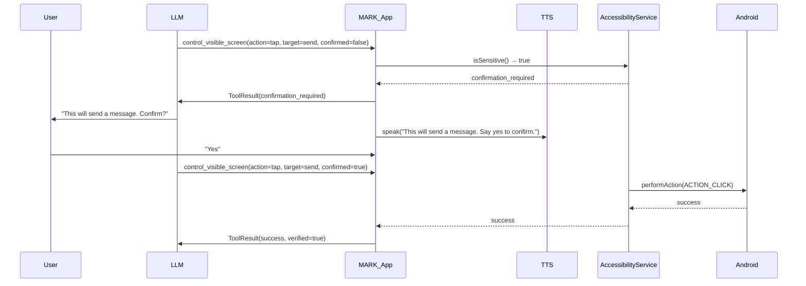

# ANDROID_PERMISSIONS_AND_SECURITY.md
## Permissions, Android Restrictions and Safety

**Project:** MARK (formerly JARVIS) — Universal Android App Control System  
**Last Updated:** 2026-11-16

---

## 1. PERMISSION ARCHITECTURE

### 1.1 Current MARK Permissions (AndroidManifest.xml)

```xml
<!-- Internet access for Gemini AI -->
<uses-permission android:name="android.permission.INTERNET" />

<!-- Optional, user-enabled access to shared storage -->
<uses-permission android:name="android.permission.MANAGE_EXTERNAL_STORAGE" />

<!-- Microphone access for voice commands -->
<uses-permission android:name="android.permission.RECORD_AUDIO" />
<!-- Required for the flashlight API and explicit, user-triggered still-image capture. -->
<uses-permission android:name="android.permission.CAMERA" />

<uses-permission android:name="android.permission.FOREGROUND_SERVICE" />
<uses-permission android:name="android.permission.FOREGROUND_SERVICE_MICROPHONE" />
<uses-permission android:name="android.permission.FOREGROUND_SERVICE_SPECIAL_USE" />
<uses-permission android:name="android.permission.POST_NOTIFICATIONS" />

<!-- Optional assistant capabilities; each is requested separately from the UI. -->
<uses-permission android:name="android.permission.READ_CONTACTS" />
<uses-permission android:name="android.permission.WRITE_CONTACTS" />
<uses-permission android:name="android.permission.CALL_PHONE" />
<uses-permission android:name="android.permission.READ_PHONE_STATE" />
<uses-permission android:name="android.permission.SEND_SMS" />
<uses-permission android:name="android.permission.READ_SMS" />
<uses-permission android:name="android.permission.RECEIVE_SMS" />
<uses-permission android:name="android.permission.READ_CALENDAR" />
<uses-permission android:name="android.permission.WRITE_CALENDAR" />
<uses-permission android:name="android.permission.BLUETOOTH_SCAN" android:usesPermissionFlags="neverForLocation" />
<uses-permission android:name="android.permission.BLUETOOTH_CONNECT" />
<uses-permission android:name="android.permission.BLUETOOTH_ADVERTISE" />
<uses-permission android:name="android.permission.READ_CALL_LOG" />
<uses-permission android:name="android.permission.WRITE_CALL_LOG" />
<uses-permission android:name="android.permission.READ_EXTERNAL_STORAGE" android:maxSdkVersion="32" />
<uses-permission android:name="android.permission.READ_MEDIA_IMAGES" />
<uses-permission android:name="android.permission.READ_MEDIA_VIDEO" />
<uses-permission android:name="android.permission.READ_MEDIA_AUDIO" />
<uses-permission android:name="android.permission.SCHEDULE_EXACT_ALARM" />

<!-- Network status -->
<uses-permission android:name="android.permission.ACCESS_NETWORK_STATE" />

<!-- Package visibility: only apps with launcher activity -->
<queries>
    <intent>
        <action android:name="android.intent.action.MAIN" />
        <category android:name="android.intent.category.LAUNCHER" />
    </intent>
</queries>
```

### 1.2 Permission Categories

| Category | Permissions | Grant Method | MARK Usage |
|----------|-------------|--------------|------------|
| **Core Voice** | `RECORD_AUDIO`, `POST_NOTIFICATIONS`, `FOREGROUND_SERVICE_MICROPHONE` | Runtime + Service | Voice conversation, wake word |
| **Accessibility** | `BIND_ACCESSIBILITY_SERVICE` (service perm) | Settings → Accessibility | UI inspection, control |
| **Camera/Flashlight** | `CAMERA` | Runtime | Flashlight, single photo capture |
| **Storage** | `MANAGE_EXTERNAL_STORAGE`, `READ_MEDIA_*` | Settings + Toggle | File management (opt-in) |
| **Assistant Features** | `READ_CONTACTS`, `CALL_PHONE`, `SEND_SMS`, etc. | Runtime per feature | Contacts, calls, SMS, calendar |
| **System** | `INTERNET`, `ACCESS_NETWORK_STATE`, `SCHEDULE_EXACT_ALARM` | Install-time | Backend comms, alarms |

### 1.3 Special Permissions (Not Standard Runtime)

| Permission | Type | Grant Flow |
|------------|------|------------|
| `BIND_ACCESSIBILITY_SERVICE` | Service permission (system-enforced) | User enables in Settings → Accessibility → MARK |
| `MANAGE_EXTERNAL_STORAGE` | Special app access | User toggles in MARK Settings → opens `ACTION_MANAGE_APP_ALL_FILES_ACCESS_PERMISSION` |
| `POST_NOTIFICATIONS` | Runtime (Android 13+) | Standard runtime prompt |
| `SCHEDULE_EXACT_ALARM` | Special app access | User grants in Settings → Alarms & reminders |
| `FOREGROUND_SERVICE_*` | Manifest + Runtime | Declared in manifest, service starts with type |

---

## 2. ANDROID VERSION RESTRICTIONS

### 2.1 API Level Requirements

| Feature | Min API | Target API | Notes |
|---------|---------|------------|-------|
| AccessibilityService | 18 | 36 | Core functionality |
| `canRetrieveWindowContent` | 18 | - | Required for UI tree |
| `canPerformGestures` | 24 | - | Required for `dispatchGesture()` |
| `takeScreenshot()` | 30 | - | Requires `canTakeScreenshot="true"` in config |
| `takeScreenshotOfWindow()` | 34 | - | Window-specific capture |
| `GestureDescription.Builder.setDisplayId()` | 30 | - | Multi-display support |
| MediaProjection | 21 | - | Foreground service required API 29+ |
| MediaProjectionConfig | 34 | - | App-specific capture (Android 14+) |
| Package Visibility `<queries>` | 30 | - | Required for `queryIntentActivities()` |
| `FOREGROUND_SERVICE_MICROPHONE` | 29 | - | Microphone foreground service type |
| `FOREGROUND_SERVICE_SPECIAL_USE` | 34 | - | Shake gesture service type |
| `MANAGE_EXTERNAL_STORAGE` | 30 | - | Full file access (Android 11+) |
| ML Kit Text Recognition v2 | 23 | - | OCR |

### 2.2 Android 11+ (API 30+) Changes

**Package Visibility:**
- Apps targeting API 30+ cannot see all installed apps by default
- MARK uses `<queries>` with launcher intent → compliant
- `QUERY_ALL_PACKAGES` NOT used → Play Store compliant

**Foreground Services:**
- Must declare `foregroundServiceType` in manifest
- `FOREGROUND_SERVICE_MICROPHONE` for voice (API 29+)
- `FOREGROUND_SERVICE_SPECIAL_USE` for shake (API 34+)
- `FOREGROUND_SERVICE_MEDIA_PROJECTION` if using MediaProjection

**Storage Access:**
- Scoped storage enforced (API 29+)
- `MANAGE_EXTERNAL_STORAGE` for full access (API 30+)
- MediaStore for media files (API 29+)

### 2.3 Android 12+ (API 31+) Changes

**Bluetooth Permissions:**
- `BLUETOOTH_SCAN`, `BLUETOOTH_CONNECT`, `BLUETOOTH_ADVERTISE` replace legacy `BLUETOOTH`/`BLUETOOTH_ADMIN`
- `neverForLocation` flag for scan

**Exact Alarms:**
- `SCHEDULE_EXACT_ALARM` special permission required
- User grants in Settings

**Notification Trampoline:**
- Cannot start activity from notification trampoline
- MARK uses `PendingIntent.getActivity` directly

### 2.4 Android 13+ (API 33+) Changes

**Notification Permission:**
- `POST_NOTIFICATIONS` runtime permission required
- MARK requests before starting voice service

**Media Permissions:**
- `READ_MEDIA_IMAGES`, `READ_MEDIA_VIDEO`, `READ_MEDIA_AUDIO` replace `READ_EXTERNAL_STORAGE`
- Granular media access

**Foreground Service Types:**
- New types: `HEALTH`, `REMOTE_MESSAGING`, etc.
- `FOREGROUND_SERVICE_SPECIAL_USE` for shake gesture

### 2.5 Android 14+ (API 34+) Changes

**MediaProjection:**
- Per-session user consent (cannot reuse token)
- `MediaProjectionConfig` for app/window selection
- `onCapturedContentResize`, `onCapturedContentVisibilityChanged` callbacks

**Foreground Service:**
- Must start foreground service BEFORE `getMediaProjection()`
- `FOREGROUND_SERVICE_MEDIA_PROJECTION` type required

**Bluetooth:**
- `BLUETOOTH_ADVERTISE` permission for advertising

---

## 3. MARK SERVICE ARCHITECTURE & PERMISSIONS

### 3.1 Services and Their Permissions

| Service | Foreground Type | Permissions Required | Purpose |
|---------|-----------------|---------------------|---------|
| `JarvisVoiceForegroundService` | `microphone` | `RECORD_AUDIO`, `POST_NOTIFICATIONS` (API 33+), `FOREGROUND_SERVICE_MICROPHONE` | Voice conversation |
| `JarvisWakeWordService` | `microphone` | `RECORD_AUDIO`, `FOREGROUND_SERVICE_MICROPHONE` | Offline wake word (Vosk) |
| `JarvisGestureWakeService` | `specialUse` | `FOREGROUND_SERVICE_SPECIAL_USE` | Shake gesture detection |
| `JarvisAccessibilityService` | N/A (system-bound) | `BIND_ACCESSIBILITY_SERVICE`, `canRetrieveWindowContent`, `canPerformGestures`, `canTakeScreenshot` | UI control |
| `JarvisNotificationListenerService` | N/A | `BIND_NOTIFICATION_LISTENER_SERVICE` | Notification access (opt-in) |
| `JarvisVoiceInteractionService` | N/A | `BIND_VOICE_INTERACTION` | Assistant integration |
| `JarvisRecognitionService` | N/A | `BIND_SPEECH_RECOGNITION_SERVICE` | Speech recognition |

### 3.2 Service Lifecycle & Permission Handling

```kotlin
// JarvisVoiceForegroundService.kt - Current Implementation
override fun onStartCommand(intent: Intent?, flags: Int, startId: Int): Int {
    when (intent?.action) {
        ACTION_START -> {
            startForeground(NOTIFICATION_ID, buildNotification("Starting MARK voice listening"))
            if (!isRunning) {
                isRunning = true
                sendStatus("CONNECTING TO MARK LIVE...")
                voiceManager?.startListening()
                updateNotification("MARK is listening")
            }
        }
        ACTION_STOP -> {
            isRunning = false
            stopForeground(STOP_FOREGROUND_REMOVE)
            stopSelf()
        }
    }
    return START_NOT_STICKY
}
```

**Key Points:**
- Services use `ContextCompat.startForegroundService()` (API 26+)
- `stopService()` used for stopping (not second start command)
- `onTaskRemoved` → `stopSelf()` to clean up
- `destroyed` atomic flag prevents double cleanup

---

## 4. SECURITY BOUNDARIES

### 4.1 What MARK CAN Do

| Capability | Implementation | Safety Control |
|------------|----------------|----------------|
| Inspect visible UI | AccessibilityService `getRootInActiveWindow()` | User-enabled service |
| Tap clickable elements | `performAction(ACTION_CLICK)` | Snapshot ref validation |
| Type in editable fields | `performAction(ACTION_SET_TEXT)` | Snapshot ref validation |
| Scroll scrollable containers | `performAction(ACTION_SCROLL_*)` | Snapshot ref validation |
| Global navigation | `performGlobalAction(BACK/HOME/RECENTS)` | No ref needed |
| Visual fallback tap | `dispatchGesture()` with grid token | 15s expiry, single-use |
| Launch apps | `getLaunchIntentForPackage()` | Launcher intent query only |
| Open Settings | Explicit Settings intents | Predefined list only |
| Flashlight | `CameraManager.setTorchMode()` | Camera permission + user grant |
| Capture single photo | `CameraDevice` + `ImageReader` | Camera permission + explicit request |
| File management (SAF) | Storage Access Framework | User-selected folder only |
| File management (Full) | `Environment.getExternalStorageDirectory()` | `MANAGE_EXTERNAL_STORAGE` + in-app toggle |
| Persistent memory | SharedPreferences | App-private, user-controlled |

### 4.2 What MARK CANNOT / MUST NOT Do

| Restricted Action | Reason | Enforcement |
|-------------------|--------|-------------|
| Bypass password/PIN/pattern | Android security | `FLAG_SECURE` windows block accessibility/screenshot |
| Bypass biometric auth | Android security | System handles auth, no API to bypass |
| Bypass OTP/2FA | Security | No access to SMS/notification content without permission |
| Bypass CAPTCHA | Anti-bot | Visual fallback cannot solve CAPTCHA |
| Access `FLAG_SECURE` windows | Privacy | `takeScreenshot()` returns `ERROR_TAKE_SCREENSHOT_SECURE_WINDOW` |
| Silent permission grants | Android permission model | All runtime permissions require user prompt |
| Silent app installs | Play Protect | `REQUEST_INSTALL_PACKAGES` not declared |
| Modify system settings | Android protected settings | Settings intents open UI, user must change |
| Access other app data | Sandbox | No `READ_EXTERNAL_STORAGE` for app-private dirs |
| Keylogging | Privacy | Only types in focused editable field via accessibility |
| Screen recording | Privacy | Only single screenshots via accessibility, no MediaProjection |
| Background microphone without notification | Privacy | Foreground service + persistent notification required |

### 4.3 Confirmation Gates (Mandatory)

```kotlin
// Current MARK Implementation - JarvisAccessibilityService.isSensitive()
private fun isSensitive(action: String, target: String, text: String): Boolean {
    val value = "$action $target $text".lowercase(Locale.ROOT)
    return listOf(
        "send", "submit", "purchase", "buy", "pay", "delete", "remove",
        "call", "share", "post", "publish", "transfer", "confirm", "install"
    ).any(value::contains)
}

// LiveVoiceManager.executeTaskTool() - Confirmation Gating
if (isPotentiallySensitive(name, args) && !confirmed) {
    awaitingTaskConfirmation = true
    taskState = TaskState.WAITING_FOR_CONFIRMATION
    return ToolResult("confirmation_required", 
        "Confirmation required before this action. Ask the user to confirm, then repeat with confirmed=true.")
}
```

**Actions Requiring Explicit Confirmation:**

| Category | Examples | Confirmation Method |
|----------|----------|---------------------|
| Messaging | WhatsApp send, SMS, Email send | Local TTS prompt + `confirmed=true` |
| Calls | Phone dial, VoIP | Local TTS prompt + `confirmed=true` |
| Payments | GPay, Play Store, In-app purchase | Local TTS prompt + `confirmed=true` |
| Deletion | Messages, files, contacts, emails | Local TTS prompt + `confirmed=true` |
| Public posting | Social media posts, stories, tweets | Local TTS prompt + `confirmed=true` |
| Sharing personal | Location, contacts, photos | Local TTS prompt + `confirmed=true` |
| Security settings | Lock screen, biometrics, permissions | Local TTS prompt + `confirmed=true` |
| App install | Play Store, APK | Local TTS prompt + `confirmed=true` |

### 4.4 Confirmation Flow



---

## 5. PRIVACY PROTECTIONS

### 5.1 Data Handling Principles

| Principle | Implementation |
|-----------|----------------|
| **On-device processing** | All UI inspection, OCR, planning on device |
| **Minimal cloud data** | Only voice audio → Gemini Live; no screenshots to cloud unless visual fallback |
| **User control** | All permissions opt-in; Accessibility service user-enabled |
| **No persistent screen recording** | Only single screenshots on demand |
| **Memory isolation** | `JarvisMemoryStore` app-private, user-clearable |
| **No credential storage** | Never stores passwords, tokens, OTPs |

### 5.2 Visual Fallback Privacy

```kotlin
// Current Implementation - Visual Token Security
// 1. Screenshot only on explicit tool call (inspect_visual_screen)
// 2. Grid overlay prevents direct pixel access
// 3. Token expiry: 15 seconds
// 4. Single-use: consumed after one visual_tap
// 5. Area tracking: prevents duplicate taps in same region
// 6. Sent only to active Gemini Live session (not stored)
// 7. Secure windows (banking, auth) blocked by system
```

### 5.3 Voice Data Flow

```
Microphone (16kHz PCM) 
    → AudioRecord (on-device) 
    → WebSocket (Gemini Live, encrypted) 
    → Gemini processes audio 
    → Audio response (24kHz PCM) 
    → AudioTrack (on-device playback)
    → NO voice stored locally (except optional transcript)
```

### 5.4 Network Security

```kotlin
// Cloudflare Worker Backend
// - Gemini API key stored ONLY in Cloudflare secret (not in app, not in repo)
// - App requests short-lived token via POST /live-token
// - Token used for single Gemini Live session
// - All traffic HTTPS/TLS 1.2+
// - Certificate pinning recommended for production
```

---

## 6. PLAY STORE POLICY COMPLIANCE

### 6.1 Accessibility Service Policy

**Google Play Requirements for Accessibility Services:**
1. **Must help users with disabilities** → MARK qualifies as assistive tool
2. **Must declare purpose** → `android:description` in config XML
3. **Must not request unnecessary permissions** → MARK only requests needed caps
4. **Must have privacy policy** → Required for Play Store listing
5. **Must not misuse** → MARK only uses for user-requested actions

**MARK Compliance:**
- ✅ `android:description="@string/accessibility_service_description"` explains purpose
- ✅ `canRetrieveWindowContent`, `canPerformGestures`, `canTakeScreenshot` declared
- ✅ No `QUERY_ALL_PACKAGES` permission
- ✅ User must explicitly enable in Settings
- ✅ Confirmation gates for sensitive actions
- ✅ Visual fallback tokens expire, single-use

### 6.2 Foreground Service Policy

**Requirements:**
- ✅ Proper `foregroundServiceType` declared
- ✅ Persistent notification with stop action
- ✅ `START_NOT_STICKY` to avoid unwanted restarts
- ✅ Microphone type for voice services

### 6.3 Permission Declaration

**High-Risk Permissions Requiring Play Console Declaration:**
- `MANAGE_EXTERNAL_STORAGE` → Requires Permissions Declaration Form
- `READ_SMS` / `RECEIVE_SMS` / `SEND_SMS` → Requires Declaration Form
- `CALL_PHONE` → Requires Declaration Form
- `ACCESSIBILITY` → Reviewed under Accessibility API policy

**MARK Approach:**
- Core features work without high-risk permissions
- Assistant features (SMS, calls, contacts) opt-in per feature
- User grants only what they need

---

## 7. THREAT MODEL & MITIGATIONS

### 7.1 Attack Vectors

| Threat | Likelihood | Impact | Mitigation |
|--------|------------|--------|------------|
| Malicious app impersonating MARK | Low | High | Play Store signing, package name uniqueness |
| Accessibility service abuse by other apps | Medium | High | `BIND_ACCESSIBILITY_SERVICE` system-enforced |
| Voice command injection | Low | Medium | Local wake word (Vosk), confirmation gates |
| Visual fallback data leakage | Low | Medium | Token expiry, single-use, no storage |
| Prompt injection via screen content | Medium | Medium | LLM system instructions, verification |
| Permission overreach | Low | High | Minimal permissions, opt-in features |
| Man-in-the-middle (network) | Low | High | TLS 1.2+, certificate pinning |

### 7.2 Prompt Injection Defense

```kotlin
// System Instruction includes:
"""
Never bypass passwords, biometrics, CAPTCHAs, Android permission dialogs, or security screens.
For sending, deleting, purchasing, calling, sharing, posting, installing, or other consequential actions, 
ask the user for confirmation first and then repeat the blocked action with confirmed=true only after the user explicitly agrees.
If the user says stop, cancel, or abort, call cancel_task immediately.
"""
```

### 7.3 Verification as Defense

- Every action verified before next step
- Stale ref detection prevents acting on old UI
- Visual token prevents coordinate replay
- Confirmation gates prevent unauthorized sensitive actions

---

## 8. TESTING PERMISSIONS & SECURITY

### 8.1 Permission Test Matrix

| Permission | Test Scenario | Expected Result |
|------------|---------------|-----------------|
| `RECORD_AUDIO` | Deny → Start voice | "MICROPHONE PERMISSION REQUIRED" |
| `POST_NOTIFICATIONS` | Deny (API 33+) → Start voice | "NOTIFICATION PERMISSION REQUIRED" |
| `CAMERA` | Deny → Flashlight | "Camera permission required" |
| `BIND_ACCESSIBILITY_SERVICE` | Disable service → Inspect screen | "Accessibility control not enabled" |
| `MANAGE_EXTERNAL_STORAGE` | Disable → File ops | "Enable Full storage access" |
| `SCHEDULE_EXACT_ALARM` | Deny → Set alarm | Graceful degradation |

### 8.2 Security Test Cases

```kotlin
// Test: Secure window screenshot blocked
@Test
fun `secure window screenshot fails`() {
    // Open banking app (FLAG_SECURE)
    val result = accessibilityService.captureVisualScreen()
    assertFalse(result.first)
    assertEquals(ERROR_TAKE_SCREENSHOT_SECURE_WINDOW, result.errorCode)
}

// Test: Stale ref rejected
@Test
fun `stale ref rejected after screen change`() {
    val snapshot1 = inspectScreen()
    val ref = snapshot1.refs.first()
    // Navigate to different screen
    navigateToOtherScreen()
    val result = controlScreen(snapshot1.id, ref, "tap")
    assertFalse(result.success)
    assertEquals("STALE_REF", result.errorType)
}

// Test: Visual token expiry
@Test
fun `visual token expires after 15s`() {
    val capture = inspectVisualScreen()
    Thread.sleep(16000)
    val result = controlScreen(visualTap, capture.token, "C7")
    assertFalse(result.success)
    assertTrue(result.message.contains("expired"))
}

// Test: Confirmation required for send
@Test
fun `send action requires confirmation`() {
    val result = controlScreen(tap, sendButtonRef, confirmed = false)
    assertEquals("confirmation_required", result.status)
}
```

---

## 9. PRODUCTION HARDENING CHECKLIST

### 9.1 Pre-Release Security Audit

- [ ] All permissions justified and documented
- [ ] Accessibility service description accurate
- [ ] No `QUERY_ALL_PACKAGES` permission
- [ ] No hidden/undocumented features
- [ ] Confirmation gates on ALL sensitive actions
- [ ] Visual fallback tokens: expiry, single-use, area tracking
- [ ] No screen data persisted (except user memory)
- [ ] Network traffic: only to Cloudflare Worker + Gemini
- [ ] Certificate pinning implemented
- [ ] ProGuard/R8 obfuscation enabled
- [ ] Debug logging removed from release build
- [ ] Crash reporting without PII

### 9.2 Privacy Policy Requirements

- [ ] Data collected: Voice audio (transient), User memories (opt-in), Usage analytics (opt-in)
- [ ] Data shared: Voice audio → Gemini Live (Google), Crash reports (if enabled)
- [ ] Data stored: Memories (local), Preferences (local), App knowledge (bundled)
- [ ] User rights: Delete memories, Disable features, Uninstall
- [ ] Children's privacy: Not directed at children under 13

### 9.3 Accessibility Service Review

- [ ] Service only activates on user enable
- [ ] No background monitoring without user action
- [ ] Screenshots only on explicit tool call
- [ ] Gestures only on explicit tool call
- [ ] No keylogging or input capture beyond focused field
- [ ] Respects `FLAG_SECURE` windows

---

*End of ANDROID_PERMISSIONS_AND_SECURITY.md*